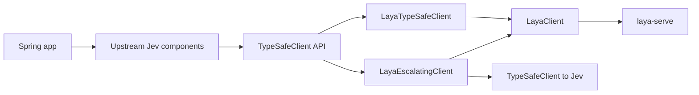

# Laya as a spring-ai-typesafe backend: end-to-end analysis

Date: 2026-10-31.
Versions: Laya 0.4.19 (`laya-serve`, english checkpoint, revision `7b928d82`), spring-ai-typesafe 0.4.0, Spring AI 2.0.1, Spring Boot 4.0.7.

## 1. Summary

- **Laya already speaks the Jev wire protocol, so spring-ai-typesafe can run on it today by changing the base URL.** What it can't do is read the result correctly. On Laya the `confidence` field is a different quantity from Jev's. On the 554 benchmark examples, feeding it to `JevConfidenceGate` (floor 0.6) escalated 46% of SST-2 answers where Jev's formula escalates 25.5%, and the answers that changed decision were 92.7% correct.
- **This project fixes that without touching upstream.** `LayaTypeSafeClient` is a `TypeSafeClient` subclass. Every upstream component (`JevDocumentFilter`, `JevDocumentReranker`, `JevJudge`, `JevConfidenceGate`, `JevGuardrailAdvisor`, `JevToolIndex`) runs on it unmodified. It also:
  - models Laya's extra endpoints and fields;
  - batches `systemOneAll` through Laya's batch endpoint;
  - adds `LayaEscalatingClient`, which uses Laya first and escalates to Jev.
- **Laya's accuracy matches what its makers publish.**

  | Dataset (labels) | Accuracy here | Published |
  |---|---|---|
  | SST-2 (2) | 0.910 | 0.920 |
  | AG News (4) | 0.935 | no published figure |
  | Banking77 (77) | 0.370 | 0.363 |

  Calibration (`answer_confidence`) is good on small label sets (ECE 0.05 and 0.067) and useless on 77 labels (ECE 0.527): there, even at a 0.9 floor Laya would still serve 75% of requests at 43.5% accuracy. So escalation for wide choices has to key on the option count, not on confidence. That is what `LayaEscalatingClient` does.
- **Speed on this CPU laptop is not a reason to use Laya.** A one-question request took p50 1 to 5 s depending on the host's state. The batch path helped short one-question work (1.9x to 5.2x) but not long multi-question passages. Laya's case rests on local data, no per-call price, fine-tuning, and speed on a GPU, which I could not test.
- **Recommendation:** propose the code upstream as an addition in new `laya` packages. Keep the escalation client and the confidence fix. Make no claims about CPU speed. Ask the maintainers to run the benchmark on a GPU and with a Jev key.

## 2. What upstream does today

`spring-ai-typesafe/docs/client/Laya.md` tells users to point `TypeSafeClient` at `laya-serve`. I verified each protocol difference against a live 0.4.19 server:

| Area | Laya 0.4.19 (observed) | Effect on a plain `TypeSafeClient` |
|---|---|---|
| `confidence` on choice and score | normalised entropy `1 - H(p)/log n` | Every Jev-tuned threshold gates a different number (section 5.3). |
| Extra answer fields | `answer_confidence`, `x_jev_confidence`, `action`, abstention fields | Dropped by `@JsonIgnoreProperties(ignoreUnknown = true)`. |
| Routing, usage | `routing{model, repo, reason, detection}`, truncation counts | Dropped. A silently truncated state is invisible. |
| `POST /v1/systemone/batch` | one question set over up to 64 states | Not used. `systemOneAll` sends one request per item. |
| `GET /v1/models` | 404 | `listModels()` throws. |
| API key | optional | Mandatory in the client. |
| Errors | `{"detail"}`; 413 for size limits, 503 with `Retry-After: 1` when full, 422 for a noul without instructions | 413 becomes a generic exception, and the noul case is only discovered on the wire. |

## 3. What was built

| Class | Role |
|---|---|
| `LayaClient` | Native client for `/v1/systemone`, `/v1/systemone/batch`, `/v1/route` and `/health`. Sends optional bearer auth, and omits `model` for auto-routing. Accepts `LayaOptions` (`task`, `lang`, `lang_guess`, `max_len`, `head_max_len`, `min_confidence` as a number or per-bucket map). Checks limits client-side (`LayaLimits`). Uses the same retry loop and `RetryPolicy` as upstream, and maps errors to typed 413 and 503 exceptions. |
| `LayaResponse` and records | The answers as upstream `SystemOneResponse`, plus per-answer `LayaAnswerDetails`, `LayaUsage` (truncation), `LayaRouting` and the server inference time. `toTypeSafe(ConfidenceMetric)` produces the Jev view. Every Laya field is nullable, so a server in `LAYA_JEV_STRICT=1` mode still parses. |
| `LayaTypeSafeClient` | Drop-in `TypeSafeClient`. Rewrites `confidence` to the chosen `ConfidenceMetric` (default `JEV`). Its `systemOneAll` groups identical question sets, sorts each group by state length, and sends batch calls of at most `rowsPerBatchCall` rows (default 16), with at most `maxConcurrentBatchCalls` (default 1) in flight. A refused state is isolated in its own slot, and results stay aligned. `listModels()` comes from `/health`. |
| `LayaEscalatingClient` | Laya first. Escalates to any `TypeSafeClient` on: `TOO_MANY_OPTIONS` (more than 20 options, never sent to Laya), `LAYA_FAILED` (connection, 5xx, 408, 413), `ABSTAINED` (Laya's own gate), or `LOW_CONFIDENCE` (`answer_confidence` below the floor). Batches on Laya first, then escalates only the slots that need it. Reports through `stats()` and an `EscalationListener`. |
| `LayaAutoConfiguration` | `spring.ai.laya.base-url` switches the `TypeSafeClient` bean to Laya. Setting `escalation.enabled=true` builds the escalating client over a Jev client from `spring.ai.typesafe.*`, and only if `escalation.allow-external-data-export=true` confirms that escalated requests may leave the environment. Your own bean wins. |

Tests:
- 53 unit tests (MockRestServiceServer, using responses captured from the live server): 39 in the Java client, 10 in the starter, 4 running spring-ai-typesafe components.
- 12 live integration tests (8 SDK, 4 upstream components), run against `laya-serve` 0.4.19.

Every test passes.

## 4. Benchmark method

- **Host:** Windows 11 laptop, 14 logical cores, CPU only (Intel graphics, no CUDA). `laya-serve` 0.4.19 runs with `LAYA_DEVICE=cpu`, `LAYA_THREADS=8`, english checkpoint only.
- **Data:** public labelled datasets from the Hugging Face datasets-server, sampled with a fixed seed:
  - SST-2 validation: 200 of 872.
  - AG News test: 200 drawn from three spread-out pages.
  - Banking77 test: 2 per intent, 154 in total.
- **Setup:**
  - One `Choice` question per example, with the label names as options and a short description each.
  - Zero-shot, no fine-tuning, no `head_max_len` tuning.
  - Accuracy runs go through `systemOneBatch`, 32 states per call (8 for Banking77).
- **Metrics:**
  - Accuracy.
  - ECE with 10 equal-width bins, for each of the three confidence numbers.
  - Selective accuracy at `answer_confidence` floors.
  - `JevConfidenceGate` (floor 0.6) decisions under the native confidence vs Jev's formula.
- **Jev:** not measured, because no `TYPESAFE_API_KEY` was available. The harness runs a strict [same-data, same-question parity comparison](https://github.com/vaquarkhan/spring-ai-laya/blob/main/laya-benchmarks/BENCHMARK-PROTOCOL.md) when a key is supplied. It records SHA-256 receipts of the ordered inputs and question payload, configured model IDs, and fails if either backend leaves any input unanswered. Jev figures below are the ones laya-ai.com published from its own same-question test, labelled as such.
- **Reproduce:** `mvn -pl laya-benchmarks exec:java`. The raw output is in `laya-benchmarks/results/`.

## 5. Results

### 5.1 Accuracy

| Dataset | Labels | Laya here | Laya published | Jev published |
|---|---|---|---|---|
| SST-2 | 2 | **0.910** (n=200) | 0.920 (n=300) | 0.963 |
| AG News | 4 | **0.935** (n=200) | none | none |
| Banking77 | 77 | **0.370** (n=154) | 0.363 (n=300) | 0.813 |

Laya is close to Jev on small label spaces and far behind on large ones. The reproduction agrees with laya-ai.com to within about 1 point.

### 5.2 Calibration

| Dataset | ECE `answer_confidence` | ECE Jev formula | ECE native `confidence` |
|---|---|---|---|
| SST-2 | **0.050** | 0.176 | 0.375 |
| AG News | **0.067** | 0.095 | 0.221 |
| Banking77 | 0.527 | 0.523 | 0.549 |

`answer_confidence` is the number to threshold on Laya, as Laya's docs say. The native `confidence` that a plain client passes on is the least calibrated of the three. On 77 labels all three are badly over-confident.

### 5.3 The confidence mismatch, measured

`JevConfidenceGate` with its default floor of 0.6, fed each Laya answer two ways:

| Dataset | Escalated (native, i.e. plain client) | Escalated (Jev formula, i.e. adapter) | Decisions that differ | Accuracy of those answers |
|---|---|---|---|---|
| SST-2 | 46.0% | 25.5% | 20.5% | 92.7% |
| AG News | 24.0% | 9.0% | 15.0% | 96.7% |
| Banking77 | 7.1% | 13.0% | 5.8% | 33.3% |

On the two well-calibrated tasks, the plain client sends one answer in five (SST-2) or one in seven (AG News) to a human when nothing is wrong with it. More than 92% of those answers are correct.

A unit test pins the same effect on one captured Laya answer. Billing at p=0.8834 has native confidence 0.4805, so the gate returns ESCALATE. Jev's formula gives 0.7668, so the gate returns EXECUTE.

### 5.4 Serving only confident answers

This shows what Laya serves, and how accurately, at each `answer_confidence` floor. Everything below the floor would escalate to Jev.

| Floor | SST-2 served / accuracy | AG News served / accuracy | Banking77 served / accuracy |
|---|---|---|---|
| none | 100% / 0.910 | 100% / 0.935 | 100% / 0.370 |
| 0.70 | 84% / 0.952 | 91% / 0.973 | 85% / 0.389 |
| 0.75 | 80% / 0.956 | 87% / 0.971 | 83% / 0.402 |
| 0.80 | 75% / 0.966 | 85% / 0.976 | 80% / 0.407 |
| 0.90 | 61% / 0.975 | 64% / 0.984 | 75% / 0.435 |

At the default floor of 0.75, Laya serves 80 to 87% of the two small-label tasks at 95.6 to 97.1% accuracy. Those are higher than Laya's overall accuracy (91 and 93.5%), and close to the 0.963 Jev publishes for SST-2. On Banking77 the floor does almost nothing, which is why `LayaEscalatingClient` routes choices with more than 20 options straight to Jev.

### 5.5 Latency and throughput (CPU, this host)

**The host's speed drifted by up to 5x during the day.** The same 20-request latency test gave p50 984 ms in the first run and 5,313 ms in the second. So every comparison below is interleaved (plain, adapter, plain, adapter), and all runs are shown.

| Measurement | Run 1 | Run 2 (final code) | Run 3 (final code, fresh, with receipts) |
|---|---|---|---|
| One request, one question (SST-2), n=20, p50 / p95 | 984 / 3,011 ms | 5,313 / 12,458 ms | 5,323 / 12,400 ms |
| Batched accuracy runs, ms/example | SST-2 755; AG News 2,985 (longer text); Banking77 6,078 (77 options) | not re-run | SST-2 1,090; AG News 2,290; Banking77 4,608 |
| `systemOneAll`, 32 SST-2 requests, 1 question: plain client (fan-out 4) vs adapter | 41.2 s vs 21.3 s (one call of 32 rows) | 308.4 / 69.7 s vs 58.8 / 31.7 s (16-row calls) | 151.8 / 88.0 s vs 39.7 / 37.6 s (16-row calls) |
| `JevDocumentFilter`, 16 AG News passages x 4 questions: plain vs adapter | 114.3 s vs 261.6 s (one call of 64 rows) | 137.5 / 269.2 s vs 218.4 / 218.4 s (16-row calls) | 228.7 / 142.8 s vs 128.2 / 211.5 s (16-row calls) |

Every run returned the same labels from both clients (32/32), and the filter kept the same passage. Run 3 also measured accuracy afresh and reproduced every accuracy, calibration and confidence-floor figure in sections 5.1 to 5.4 exactly, which is expected because Laya's answers are deterministic for the same input.

To choose the batch defaults, I timed the filter's four questions over 8 AG News passages directly against `laya-serve`, in two interleaved rounds (`results/raw-probes/probe4.json`):

| Shape | Round 1 | Round 2 |
|---|---|---|
| 8 single requests, sequential | 119.7 s | 98.6 s |
| 8 single requests, 4 in parallel | 251.3 s | 188.2 s |
| 1 batch call of 8 states (32 rows) | 168.6 s | 180.6 s |
| 2 batch calls of 4 states (16 rows), sequential | 238.4 s | 128.9 s |
| 2 batch calls of 4 states, in parallel | 132.9 s | 87.6 s |

What holds across every probe on this CPU host:

- **One large padded pass is never the fastest.** Rows are padded to the longest one in the pass. That is why the adapter now caps calls at 16 rows and sorts states by length before chunking.
- **Four parallel single requests are consistently slow.** That is the upstream default fan-out, and it was slower than sequential in every probe: 251 s vs 120 s, 188 s vs 99 s, and 495 s for 16 passages. That is why the adapter defaults to one call in flight.
- **Short one-question workloads gain from the batch endpoint.** The adapter was faster in all five trials: 1.9x, 5.2x, 2.2x, 3.8x and 2.3x.
- **For long multi-question workloads, CPU timing is within noise.** Batching is neither a clear gain nor a clear loss. Across four interleaved trials with the final code, the adapter won two (128 s vs 229 s, 218 s vs 269 s) and lost two (218 s vs 138 s, 211 s vs 143 s).

These are not performance claims. Laya publishes 33 ms for one question and 7.2 ms per question batched on a T4 GPU, which I could not test here. A GPU run is the first thing I'd ask a maintainer for.

### 5.6 Upstream components on Laya (live)

These come from the live integration tests. They are single runs on hand-written inputs, so they show behaviour, not accuracy.

| Component | Observed |
|---|---|
| `JevDocumentReranker` | Ranked the passage that answers the refund question first (0.855), above a contradicting one (0.083). |
| `JevDocumentFilter` | Removed the prompt-injection passage and the off-topic one. It also removed the "all sales are final" passage instead of marking it CONFLICTING, and marked the correct answer CONFLICTING. |
| `JevConfidenceGate` | "Charged twice, refund one" gave billing at 0.958 (Jev formula), so EXECUTE. |
| `JevJudge` (noul, minimum 0.5) | Failed both a correct answer ("Paris is the capital of France.") and a wrong one. |

These match the upstream `Laya.md` observation that Laya misses subtler signals and needs criteria tuned on Laya itself. The fix belongs in the criteria, or in escalating such checks to Jev. It does not belong in the client.

## 6. Benefits, with the evidence for each

| Benefit | Evidence | Strength |
|---|---|---|
| Thresholds keep their meaning on Laya | Section 5.3: 15 to 20% of decisions change, and 93 to 97% of those answers are correct | Measured here |
| A Laya-first, Jev-on-doubt client that serves most traffic locally at high accuracy | Section 5.4: 80 to 87% served at 95.6 to 97.1% accuracy (floor 0.75); wide choices routed by option count | Measured here (Laya side); Jev side not measured |
| Data stays on your infrastructure; no per-call price | Laya is Apache-2.0 and self-hosted; Jev costs $0.042 per million input tokens (laya-ai.com) | Documented |
| Faster `systemOneAll` for short "same question, many items" work | Section 5.5: 1.9x, 5.2x and 2.2x on 32 one-question requests, identical labels; no clear gain for long multi-question passages on CPU | Measured on CPU; GPU untested |
| Visibility: routing, truncation, abstention, health | `LayaResponse`, `LayaHealth`; ITs against the live server | Verified |
| Fewer wasted round trips | Limits, a noul without instructions, and score levels without descriptions are rejected before sending; 413 is never retried | Unit tests and ITs |
| Fine-tuning path | Laya documents fine-tuned 0.766 vs base 0.362 on its typed-decisions benchmark | Documented upstream; not measured |

## 7. Choosing Laya, Jev, or both

These rules follow from sections 5.1 to 5.4. The Jev figures in them are the published ones.

| Workload | Use | Why |
|---|---|---|
| Choices with 2 to ~20 options, English text, data must stay local or volume is high | Laya through `LayaTypeSafeClient` | 0.91 to 0.94 accuracy; `answer_confidence` calibrated (ECE 0.05 to 0.07) |
| The same, with an accuracy target above Laya's | `LayaEscalatingClient`, floor 0.75 to 0.8 | Laya serves 75 to 87% at 0.956 to 0.976; the rest goes to Jev |
| Choices with many options (intents, product codes) | Jev, or Laya with `LAYA_TOURNAMENT_GROUP` after measuring | Banking77 0.37 vs 0.813; confidence gives no warning (ECE 0.53) |
| Criteria that need world knowledge or subtle judgement (judges, contradiction) | Jev, or code criteria | Section 5.6, and upstream `Laya.md` |
| Non-English text | Jev, or Laya's multilingual checkpoint after measuring | Published 0.872 vs 0.544; not measured here |
| Offline development and CI | Laya | No key, no network, same API |

## 8. Limits and open questions

- **Jev was not measured.** The harness supports it, so a maintainer with a key should run it. Until then every Jev number is laya-ai.com's.
- **CPU timing is noisy on this host.** Single-request latency moved from p50 984 ms to 5,313 ms between runs, and the plain client's filter run from 114 s to 269 s. GPU measurements are needed before any speed claim.
- **Batch sizing.** `rowsPerBatchCall` (default 16) and `maxConcurrentBatchCalls` (default 1) were chosen from the CPU probes in section 5.5. The best values depend on hardware; a GPU should favour larger passes and more calls in flight.
- **Timeouts make the RAG filter fail open.** In one live run, a 16-row filter call took longer than the first default timeout of 30 s. `JevDocumentFilter` correctly passed all four passages through unscreened, prompt injection included, and logged a warning. The default is now 90 s per attempt with a 200 s budget. On a slow host, size the timeout to the workload and alert on that warning.
- **Quality on subtle criteria.** The judge and filter observations (section 5.6) mean Laya needs criteria and thresholds measured on Laya. The adapter fixes the confidence meaning, not the model's judgement.
- **The adapter needs a dummy transport.** Upstream could offer a protected no-transport constructor (see EXTRACTION.md).
